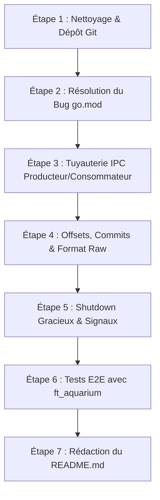

# 📋 Rapport d'Audit Complet — Projet Tree_Nity (Treenity)

> **Date de l'audit :** 28 octobre 2026  
> **Contexte :** Projet d'école 42 — Milestone 5 (Système de Message Queue asynchrone)  
> **Note d'intégrité :** Cet audit a été réalisé en lecture seule stricte. Aucun fichier source, script ou configuration du repository n'a été modifié.

---

## 📑 Table des Matières

1. [Résumé Exécutif](#1-résumé-exécutif)
2. [Fonctionnement Global du Projet](#2-fonctionnement-global-du-projet)
   - [2.1 Architecture et Rôles](#21-architecture-et-rôles)
   - [2.2 Mécanisme IPC et Protocole d'Échange](#22-mécanisme-ipc-et-protocole-déchange)
   - [2.3 Structures de Données Internes](#23-structures-de-données-internes)
   - [2.4 Cycle de Vie des Commandes](#24-cycle-de-vie-des-commandes)
3. [État d'Avancement Réel (Où en est le projet ?)](#3-état-davancement-réel-où-en-est-le-projet-)
4. [Points Forts du Projet](#4-points-forts-du-projet)
5. [Points Sensibles & Risques Majeurs (Critiques 42)](#5-points-sensibles--risques-majeurs-critiques-42)
6. [Points Faibles & Bugs Techniques Identifiés](#6-points-faibles--bugs-techniques-identifiés)
   - [6.1 Bugs Bloquants (Fonctionnels)](#61-bugs-bloquants-fonctionnels)
   - [6.2 Bugs de Concurrence & Fuites de Ressources](#62-bugs-de-concurrence--fuites-de-ressources)
   - [6.3 Faiblesses Algorithmiques](#63-faiblesses-algorithmiques)
7. [Fonctionnalités et Éléments Manquants](#7-fonctionnalités-et-éléments-manquants)
8. [Plan d'Action Recommandé (Feuille de Route)](#8-plan-daction-recommandé-feuille-de-route)
9. [Préparation à l'Évaluation entre Pairs (Soutenance 42)](#9-préparation-à-lévaluation-entre-pairs-soutenance-42)

---

## 1. Résumé Exécutif

Le projet **Tree_Nity** (appelé *Treenity* dans le sujet officiel) est une implémentation en **Go** d'un système de messagerie distribuée orienté messages/événements (inspiré des principes d'Apache Kafka). Il permet à des producteurs (*producers*) d'envoyer des messages organisés par clés vers des canaux nommés (*topics*), et à des consommateurs (*consumers*) de s'abonner à ces topics avec filtrage par préfixe et reprise sur offset.

### Synthèse de l'état actuel :
* **Niveau d'achèvement global estimé : ~45% - 50%**.
* **Ce qui est solide :** Le parsing CLI client (`alecthomas/kong`), la structure modulaire du code, la table de hachage personnalisée (FNV-1a avec chaînage) et l'arbre préfixe (Trie), tous deux accompagnés d'excellents tests unitaires pilotés par des scénarios (*table-driven tests*).
* **Ce qui bloque complètement :** Le cœur fonctionnel du passage de messages est **inachevé**. Le client `subscribe` est un stub vide qui quitte immédiatement, et le serveur ne stocke ni ne distribue les messages reçus (`// TODO: New message logic`).
* **Risques administratifs / 42 :** Absence de `README.md` (motif d'échec direct selon le sujet), présence de binaires compilés et d'un fichier dump de 50 Ko committés dans le dépôt git, et avertissement `gitinette` sur les commits sur `main`.

---

## 2. Fonctionnement Global du Projet

### 2.1 Architecture et Rôles

Le système se compose de deux exécutables distincts :

```
                        ┌────────────────────────────────────────┐
                        │              SERVEUR                   │
                        │  PID: 1337                             │
                        │  Endpoint: /tmp/operator.server.1337   │
                        │                                        │
                        │  ┌──────────────┐   ┌──────────────┐   │
                        │  │ Topics Map   │   │ Clients Hash │   │
                        │  │ (Topics/Tree)│   │ (FNV-1a Map) │   │
                        │  └──────────────┘   └──────────────┘   │
                        └───────────────────▲────────────────────┘
                                            │ Named Pipes (FIFOs)
                    ┌───────────────────────┴────────────────────────┐
                    │                                                │
       ┌────────────┴─────────────┐                    ┌─────────────┴────────────┐
       │     CLIENT PRODUCTEUR    │                    │     CLIENT CONSOMMATEUR  │
       │ ./client <ipc> produce … │                    │ ./client <ipc> subscribe │
       │ Stdin (Text / Raw)       │                    │ (Prefix filter & Offset) │
       └──────────────────────────┘                    └──────────────────────────┘
```

1. **Le Serveur (`server`) :**
   - Point d'entrée : `src/cmd/server/main.go` -> `src/server/server.go`.
   - À l'initialisation, il génère son chemin IPC principal : `/tmp/operator.server.<PID>`, le crée sous forme de FIFO via `unix.Mkfifo` et affiche ce chemin sur `stdout`.
   - Il écoute les commandes sérialisées en JSON transmises par les clients via ce FIFO.
   - Il maintient en mémoire la liste des topics (`t.Topics`), l'index des clients abonnés (`h.Hashmap`), et lance une goroutine de broadcast (`AcceptNewMessages`) par topic créé.

2. **Le Client (`client`) :**
   - Point d'entrée : `src/cmd/client/main.go` -> `src/client/`.
   - Analyse les arguments de la ligne de commande grâce à la bibliothèque `alecthomas/kong`.
   - Crée son propre FIFO de réception de réponse sous `/tmp/operator.server.<CLIENT_PID>`.
   - Établit la connexion avec le serveur en ouvrant le FIFO du serveur en écriture, lui transmet la requête en JSON en précisant son propre chemin de retour (`Path`), puis lit la réponse.

---

### 2.2 Mécanisme IPC et Protocole d'Échange

* **Choix IPC :** Named Pipes (FIFOs POSIX) créés via l'appel système `unix.Mkfifo(path, 0666)`. Ce choix est parfaitement autorisé par le chapitre VII du sujet 42.
* **Encapsulation des échanges :**
  - Requête client (`protocol.ToServer`) :
    ```json
    {
      "command": "create",
      "datas": { "topic_name": "events" },
      "path": "/tmp/operator.server.<CLIENT_PID>"
    }
    ```
  - Réponse serveur (`protocol.ToClient`) :
    ```json
    {
      "error": null,
      "response": "topic created",
      "datas": ""
    }
    ```
  - Chaque trame JSON est délimitée par un saut de ligne (`\n`), lu via `bufio.Reader.ReadBytes('\n')`.

---

### 2.3 Structures de Données Internes

Le sujet 42 impose des contraintes strictes sur les structures de données (interdiction des types de dictionnaires standard pour l'indexation des clients) :

1. **Table de hachage personnalisée (`src/server/hashmap/`) :**
   - Implémente le hachage **FNV-1a 64-bit** (`CalculateHash`) :
     $$\text{hash} = ((\text{hash} \oplus \text{byte}) \times \text{prime}) \pmod{\text{taille}}$$
   - Résolution des collisions par **chaînage séparé** (*linked list chaining*) via la structure `Node`.
   - Protégée contre les accès concurrents par un `sync.RWMutex`.
   - Utilisée pour indexer les métadonnées de chaque client connecté (`Id`, `Topic`, `Offset`, `Prefix`, `IpcPath`, `IsActive`).

2. **Arbre préfixe Trie (`src/server/prefix/`) :**
   - Chaque topic possède une instance de `Tree` (arbre n-aire où chaque nœud est indexé par une rune `map[rune]*Tree`).
   - Les clients abonnés sont enregistrés dans les nœuds correspondant à leur préfixe d'abonnement.
   - Lors de la publication d'un message, la méthode `Filter(key)` parcourt l'arbre et collecte tous les clients dont le préfixe correspond au début de la clé du message.

---

### 2.4 Cycle de Vie des Commandes

| Commande | Syntaxe CLI | Traitement Client | Traitement Serveur |
|---|---|---|---|
| **create** | `./client <ipc> create <name>` | Envoie `CmdCreateDatas` | Valide l'ID (regex), crée le topic, lance la goroutine `AcceptNewMessages` |
| **list** | `./client <ipc> list` | Envoie `CmdListDatas` | Retourne la liste des topics séparés par des virgules (`strings.Join`) |
| **info** | `./client <ipc> info <sub_name>` | Envoie `CmdInfoDatas` | Recherche dans la `Hashmap`, renvoie les métadonnées au format JSON |
| **produce** | `./client <ipc> produce <topic> [--raw]` | Lit stdin (texte `key:body` ou binaire) et boucle | Valide l'existence du topic, mais **ne traite pas les messages** (`// TODO`) |
| **subscribe** | `./client <ipc> subscribe <topic> <name> [--prefix] [--offset] [--raw]` | Envoie la commande et **quitte immédiatement** | Enregistre l'abonné dans la `Hashmap` et dans le Trie |

---

## 3. État d'Avancement Réel (Où en est le projet ?)

```
[████████████████████░░░░░░░░░░] 45% Complété
```

| Composant / Fonctionnalité | Statut | Commentaire |
|---|:---:|---|
| **Architecture du Dépôt & Makefiles** | 🟢 90% | Règles standards implémentées, wrappers git présents |
| **Parsing des arguments Client** | 🟢 95% | Très complet avec Kong, tests de validation solides |
| **IPC (Couche FIFO Reader/Writer)** | 🟡 75% | Fonctionnel pour le mode requête/réponse, mais sans flux streaming |
| **Table de hachage personnalisée (FNV-1a)** | 🟢 85% | Conforme au sujet, chaînage testé, thread-safe |
| **Arbre de filtrage par préfixe (Trie)** | 🟢 85% | Logique de filtrage correcte et testée |
| **Commande `create`** | 🟢 90% | Validation regex et gestion des doublons ok |
| **Commande `list`** | 🟢 90% | Format conforme (séparé par des virgules) |
| **Commande `info`** | 🟢 85% | Renvoie les métadonnées du client en JSON |
| **Commande `produce` (Envoi de messages)** | 🔴 30% | Côté client ok ; **côté serveur aucun traitement des messages** |
| **Commande `subscribe` (Réception de messages)**| 🔴 15% | **Client vide (`return nil`)**, aucun canal de réception dédié |
| **Gestion des Offsets & Acknowledgment** | 🔴 10% | Stockage passif, aucun commit $N+1$, aucune reprise dynamique |
| **Mode Binaire (`--raw`) pour Consommateur** | 🔴 0% | Non implémenté |
| **Arrêt gracieux (SIGINT/SIGTERM, timeout 5s)** | 🔴 0% | Aucun gestionnaire de signaux (`os/signal`) |
| **README.md obligatoire** | 🔴 0% | **Absent du dépôt** |

---

## 4. Points Forts du Projet

1. **Structure de Code Propre et Idiomatique :**
   - Séparation claire des responsabilités : `src/client/`, `src/server/`, `src/protocol/`, `src/tests/`.
   - Utilisation de packages dédiés pour l'IPC, la hashmap, le prefix tree et les topics.

2. **Excellente Qualité des Tests Unitaires Existants :**
   - Les tests de parsing (`src/tests/parsing/`), de hashmap (`src/tests/hashmap/`) et de prefix tree (`src/tests/prefix/`) utilisent le pattern *table-driven tests* avec des scénarios externalisés très lisibles.
   - Présence d'un test de concurrence pour la hashmap (`thread_safe_test.go`) validant l'absence de crash sous charge concurrente.

3. **Conformité des Structures Algorithmiques Imposées :**
   - La table de hachage FNV-1a avec chaînage explicite remplit l'exigence formelle du sujet interdisant la `map` Go standard pour l'indexation client.
   - L'arbre préfixe Trie est performant pour les correspondances partielles de clés.

4. **Makefile et Outillage Développeur :**
   - Intégration de cibles utiles dans `utils/Makefile.dev` : `test-race`, `test-strict`, `lint`, `format`, `check`.
   - Présence de scripts de validation pour respecter les conventions de commit et de branches.

---

## 5. Points Sensibles & Risques Majeurs (Critiques 42)

> [!CAUTION]
> Ces points peuvent entraîner une note de **0 automatique** ou des pénalités éliminatoires lors de la peer-evaluation.

### 🔴 1. Absence Totale du Fichier `README.md`
* **Exigence du sujet (Chapitre IX) :** Un fichier `README.md` rédigé en anglais est **obligatoire** à la racine du dépôt.
* **Critères stricts imposés :**
  - Première ligne en italique : `*This project has been created as part of the 42 curriculum by <login1>...*`
  - Sections requises : *Description*, *Instructions*, *Resources* (avec mention obligatoire de l'usage de l'IA), *Architecture*, *IPC Choice*, *Data Structures*, *Testing*.
* **Situation actuelle :** Aucun fichier `README.md` n'existe à la racine.

### 🔴 2. Fichiers Binaires et Dumps Committés dans Git
* Les exécutables compilés `client` (5,6 Mo) et `server` (3,5 Mo) sont **actuellement trackés dans Git**.
* Un fichier `output.txt` de 50 Ko (contenant une copie concaténée de tout le code source) est également committé.
* **Absence de `.gitignore` :** Il n'y a aucun `.gitignore` dans le dépôt pour exclure les binaires, sockets temporaires ou fichiers logs.

### 🔴 3. Avertissement de `gitinette` (Non-respect de la stratégie de merge)
* L'exécution de `python3 .github/workflows/gitinette` retourne :
  ```
  Warnings (manual review needed):
    - 30 commit(s) landed directly on main outside of a merge commit
  ```
* Le guide Git de 42 impose que chaque fonctionnalité passe par une branche dédiée et soit intégrée via `git merge --no-ff`.

### 🔴 4. Version Invalide de Go dans `go.mod` (`go 1.26.0`)
* Le fichier `go.mod` déclare :
  ```go
  module treenity
  go 1.26.0
  ```
* La version Go 1.26 n'existe pas encore (versions actuelles : Go 1.22 à 1.24).
* Sur tout environnement disposant d'une version Go standard (comme Go 1.18 à 1.23), toute commande (`go build`, `go test`) échoue instantanément avec l'erreur :
  `go: errors parsing go.mod: /home/opernod/42/tree_nity/go.mod:3: invalid go version '1.26.0'`

### 🟡 5. Artefact de Copier-Coller d'IA dans les Scripts
* Dans `utils/check_commit_name.sh` (lignes 17-18) :
  ```bash
  echo "'$COMMIT_MSG' commit message does not respect required format (...)[cite: 1]."
  echo "Authorized types : feat, fix, chore, docs, refactor, test, ci, style, perf[cite: 1]."
  ```
* La présence textuelle de `[cite: 1]` trahit un copier-coller brut depuis un assistant IA. Le Chapitre IV du sujet insiste lourdement sur la responsabilité et la compréhension des codes générés.

### 🟡 6. Portabilité POSIX / macOS dans `check_branch_name.sh`
* L'expression régulière utilise `\w+` :
  `PATTERN="^(feat|fix|chore|docs|refactor|test|ci|style|perf|build|revert)/\w+$"`
* `\w` est une extension GNU qui n'est pas reconnue par `grep -E` sur les Mac de 42 (BSD grep). Le script échouera sur les postes de correction 42. Utiliser `[a-zA-Z0-9_-]+`.

---

## 6. Points Faibles & Bugs Techniques Identifiés

### 6.1 Bugs Bloquants (Fonctionnels)

#### 🐛 Bug 1 : Le client `subscribe` est vide et quitte immédiatement
Dans `src/client/subscribe.go` :
```go
func (c *Client) ExecSubscribe(cmd_struct any) *pr.Error {
    return nil
}
```
Le client envoie sa requête au serveur, affiche `subscribed to ...`, puis `ExecSubscribe` retourne `nil`. Le processus client se termine immédiatement ! Il n'écoute jamais les messages entrants, ne lit rien sur aucun FIFO, et n'affiche aucun message.

#### 🐛 Bug 2 : Le serveur ne publie aucun message (`HandleCmdMessage` incomplet)
Dans `src/server/cmd/message.go` :
```go
func HandleCmdMessage(command pr.CmdMessageDatas, topics *t.Topics) (string, any, *pr.Error) {
    // TODO: New message logic
    fmt.Println(command.Key, command.Body)
    return "", "", nil
}
```
Lorsqu'un producteur envoie un message :
1. Le message n'est **jamais envoyé** dans `topic.Topic.NewMsgChan`.
2. Il n'est **jamais stocké** dans `topic.Topic.Messages`.
3. Il n'est **jamais diffusé** aux abonnés.

#### 🐛 Bug 3 : Perte du nom du topic lors de la production de messages
Dans `src/protocol/commands.go` :
```go
type CmdMessageDatas struct {
    Key  string `json:"key"`
    Body string `json:"body"`
}
```
La structure `CmdMessageDatas` ne contient aucun champ `TopicName`. Le producteur envoie des requêtes `message` avec seulement la clé et le corps. Le serveur est donc incapable de savoir à quel topic le message est destiné !

#### 🐛 Bug 4 : Canal IPC erroné pour les abonnés
Dans `src/server/cmd/subscribe.go` :
```go
client = &pr.Client{
    Id:       command.SubscriberName,
    Topic:    command.TopicName,
    Offset:   offset,
    Prefix:   prefix,
    IpcPath:  command.IpcIdentifier, // <-- ERREUR MAJEURE !
    IsActive: true,
}
```
`command.IpcIdentifier` contient l'endpoint du **serveur** (`/tmp/operator.server.<PID>`), passé en premier argument du client.  
Le serveur enregistre donc son propre FIFO comme chemin de destination pour l'abonné ! Lors du broadcast dans `AcceptNewMessages`, il tente d'écrire les messages à destination de l'abonné dans son propre canal d'écoute principal.  
*Exigence du sujet :* Chaque client abonné doit avoir son propre canal FIFO dédié (ex. `/tmp/operator.server.1337.client0`).

---

### 6.2 Bugs de Concurrence & Fuites de Ressources

#### ⚠️ Fuite de descripteurs de fichiers (*FD Leak*) dans le Serveur
Dans `src/server/server.go` :
```go
// Dans la boucle de traitement des requêtes :
writer, write_err := ipc.NewWriter(command.Path)
if write_err != nil {
    return write_err
}
cmd.SendResponse(writer, command, res, datas, err)
// writer.Close() N'EST JAMAIS APPELÉ !
```
À chaque requête reçue d'un client, un nouveau descripteur de fichier est ouvert en écriture vers le FIFO du client et n'est jamais refermé. Le serveur va saturer la limite `ulimit -n` de l'OS au bout de quelques centaines de requêtes.

#### ⚠️ Absence totale de Graceful Shutdown (SIGINT / SIGTERM)
Le sujet spécifie (Section VI.8) :
> *"When receiving SIGINT or SIGTERM, the programs should shutdown gracefully, free appropriate resources, wait for clients to commit. After a timeout of 5 seconds, it will just exit. The server must clean up all IPC resources on stop."*

Actuellement, ni le serveur ni le client ne gèrent les signaux (`os/signal`). Si le serveur est interrompu par `Ctrl+C` :
- Les fichiers FIFO temporaires restent abandonnés dans `/tmp`.
- Aucun délai d'attente de 5 secondes n'est respecté.
- Les clients connectés restent bloqués indéfiniment en lecture.

---

### 6.3 Faiblesses Algorithmiques

1. **Table de hachage sans redimensionnement dynamique (*Rehashing*) :**
   - La taille est fixée à `ClientsHashmapSize = 64` dans `constants.go`.
   - Aucun mécanisme de doublement de capacité ni de réassignation des nœuds n'est implémenté. En présence de nombreux clients, les performances se dégradent en $O(N)$.
2. **Risque de panique sur modulo zéro :**
   - Dans `CalculateHash(key, length)`, si `length == 0`, une division par zéro provoque un crash immédiat du runtime Go.
3. **Nom de client en dur :**
   - Dans `src/client/main.go`, `NewClient()` initialise `Name: "Clément"` en dur au lieu d'utiliser l'ID passé en argument.

---

## 7. Fonctionnalités et Éléments Manquants

Pour satisfaire l'intégralité du sujet, les fonctionnalités suivantes doivent être développées :

1. **Protocole de Streaming Consommateur :**
   - Création par le client abonné d'un FIFO dédié : `<server_ipc>.<subscriber_name>` (ex: `/tmp/operator.server.1337.client0`).
   - Boucle d'écoute dans le client `subscribe` pour recevoir les messages en continu et les écrire sur `stdout`.
2. **Gestion des Offsets et Protocole d'Acquittement (Commit) :**
   - Après affichage d'un message à l'offset $N$, le client doit committer $N + 1$ auprès du serveur.
   - Le serveur doit mettre à jour l'offset du client dans sa `Hashmap`.
   - Lors de la reconnexion d'un client sans `--offset`, reprendre automatiquement à partir du dernier offset committé.
   - Envoi de l'historique des messages stockés au nouvel abonné si son offset est inférieur à l'offset courant du topic.
3. **Format Binaire Raw Consommateur :**
   - En mode `--raw`, le consommateur doit formater chaque message en binaire :  
     `[offset:int32][keysize:int32][key:bytes][valuesize:int32][value:bytes]` (en Little-Endian).
4. **Shutdown gracieux complet :**
   - Capture de `syscall.SIGINT` et `syscall.SIGTERM`.
   - Fermeture ordonnée, notification de déconnexion aux clients, timeout de 5 secondes, suppression de tous les FIFOs dans `/tmp`.
5. **Gestion stricte des codes de retour :**
   - Ordre de priorité impératif : `1` (Arguments / Connexion) > `3` (Erreur IPC) > `2` (Erreur Topic/Client).
6. **Documentation Complète :**
   - Rédaction du `README.md` obligatoire en anglais.

---

## 8. Plan d'Action Recommandé (Feuille de Route)



### Étape 1 : Assainissement du Dépôt Git
- Créer un fichier `.gitignore` contenant `server`, `client`, `output.txt`, `*.sock`, `/tmp/operator.*`.
- Supprimer de l'index Git les binaires et dumps : `git rm --cached server client output.txt`.
- Corriger dans `utils/check_commit_name.sh` les résidus de copier-coller `[cite: 1]`.
- Corriger dans `utils/check_branch_name.sh` la regex pour la compatibilité macOS : remplacer `\w+` par `[a-zA-Z0-9_-]+`.

### Étape 2 : Correction de l'Environnement de Build
- Modifier `go.mod` pour cibler une version Go réaliste et compatible : remplacer `go 1.26.0` par `go 1.22` ou `go 1.23`.
- Vérifier que `make test-strict` et `make all` s'exécutent avec succès.

### Étape 3 : Implémentation du Cœur de Messagerie
- **Routage :** Ajouter `TopicName` dans la requête `message` envoyée par le producteur.
- **Serveur :** Dans `HandleCmdMessage`, pousser le message dans `topic.Topic.NewMsgChan`.
- **Canal dédié Abonné :** Faire créer par le client abonné un FIFO spécifique `<ipc_server>.<subscriber_name>` et transmettre ce chemin au serveur lors du `subscribe`.
- **Client Consommateur :** Implémenter la boucle de lecture dans `ExecSubscribe` pour afficher les messages au format `key:body` sur `stdout`.

### Étape 4 : Gestion des Offsets et Commits
- Créer une commande de protocole interne `commit` permettant au consommateur de notifier le serveur de l'offset validé ($N+1$).
- Implémenter la relecture des anciens messages lors de la souscription avec un `--offset` antérieur.
- Implémenter l'encodage binaire pour le consommateur avec `--raw`.

### Étape 5 : Gestion des Signaux et Nettoyage
- Mettre en place `signal.Notify` sur `SIGINT` et `SIGTERM` dans le serveur et le client.
- Fermer les canaux IPC et s'assurer que tous les fichiers `/tmp/operator.*` sont supprimés à la sortie (`defer os.Remove(...)`).

### Étape 6 : Tests d'Intégration et Validation
- Tester le système avec les exécutables de test fournis par le sujet : `ft_fish` (producteur de poissons) et `ft_aquarium` (visualiseur graphique d'événements).

### Étape 7 : Documentation
- Rédiger le `README.md` en anglais en respectant à la lettre les sections requises par le sujet.

---

## 9. Préparation à l'Évaluation entre Pairs (Soutenance 42)

Lors de la soutenance, l'évaluateur vérifiera particulièrement :

1. **La commande `gitinette --evaluation` :**
   - Elle échantillonnera aléatoirement 3 commits pour vérifier la cohérence entre le message Conventional Commit et le diff réel.
2. **La justification de l'IPC (Named Pipes / FIFOs) :**
   - Être prêt à expliquer : Pourquoi des FIFOs plutôt que des files de messages POSIX (`mq_open`) ou SysV (`msgget`) ?
   - Comment est gérée la bidirectionnalité (un FIFO serveur principal + un FIFO par client).
3. **La justification des structures de données :**
   - Savoir expliquer l'algorithme FNV-1a, le principe du hachage 64-bit et la résolution des collisions par liste chaînée.
   - Expliquer la complexité de recherche dans le Trie ($O(K)$ où $K$ est la longueur de la clé) par rapport à un balayage linéaire ($O(N \times K)$).
4. **L'épreuve de modification en direct (*Recode instructions*) :**
   - Une petite modification de code sera demandée en direct (par exemple ajouter un champ dans les métadonnées de `info`, modifier un format de log ou ajuster une condition de filtrage). L'architecture modulaire actuelle facilitera grandement cette épreuve dès lors que les bugs principaux seront résolus.
